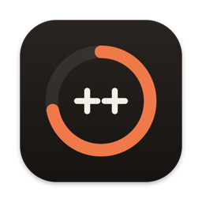
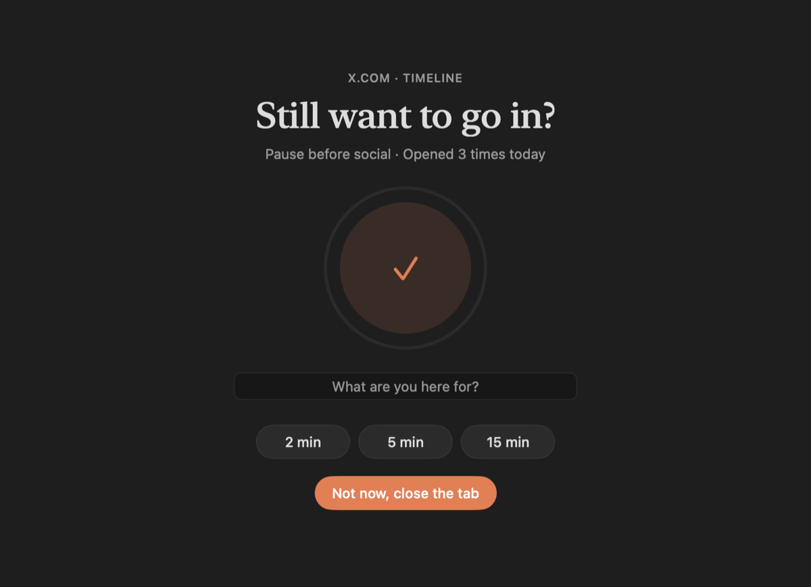
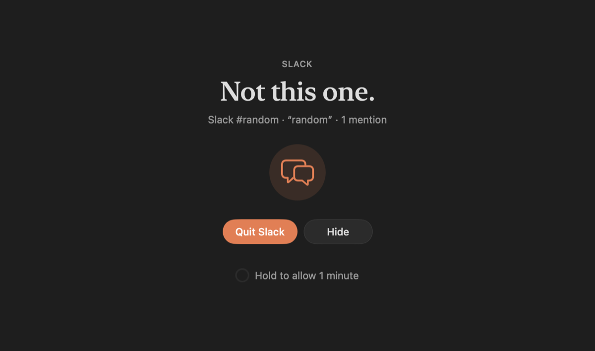

<p align="center">
  
</p>

<h1 align="center">Screentime++</h1>

<p align="center">
  Screen time and blocking for the Mac: apps, websites, and what's inside them.
</p>

<p align="center">
  <a href="https://github.com/radkawar/screentime-plus-plus/releases/latest/download/ScreentimePlusPlus-latest-macos-universal.dmg"><strong>Download the latest Screentime++</strong></a>
  <br>
  macOS 15 or later. Universal, Developer ID signed, and notarized by Apple.
</p>

Screentime++ measures where your time goes and applies rules to the apps and
websites you choose. Rules can also look inside them: block YouTube Shorts but
keep videos, block one Slack channel but keep your team's, block any page that
talks about betting. It reads the app, window title, address and visible text
through macOS Accessibility, and everything is decided on this Mac.

| Pause before you go in | Block an app on every window |
| --- | --- |
|  |  |
| A breathing wait that grows with each open, then a session you choose. | Quit or hide. Overrides need a two-second press and hold. |

## Highlights

- Apps and websites are first-class: block, pause or limit either.
- Page rules such as `youtube.com/shorts/*` or `reddit.com/` (front page only).
- Phrase rules that read the page or window text, optionally inside one app.
- Categories cover every installed app by the category it declares, plus known sites.
- Three responses: **Track** (count only), **Pause** (wait, intention, timed
  session), **Block** (shield, with an optional deliberate override).
- Daily time and open limits, weekly schedules (overnight aware), and exceptions.
- Focus sessions that block chosen rules, optionally locked until they end.
- Lock your rules until a time, so they can be tightened but not weakened.
- Today: distracting time against a daily goal, a 24-hour activity ribbon,
  pickups, streaks, and every intervention with what you said you were there for.
- History: 7 and 30 day charts by category, and time per site surface
  ("YouTube: Shorts 41m, Watch 22m").
- Inspector: what the engine sees right now and what each rule decides.
- Menu bar: today at a glance and one-click Focus.

## Install

1. [Download the latest DMG](https://github.com/radkawar/screentime-plus-plus/releases/latest/download/ScreentimePlusPlus-latest-macos-universal.dmg).
2. Open it and drag Screentime++ into Applications.
3. Open Screentime++ and follow Setup.
4. Turn on Screentime++ in System Settings > Privacy & Security > Accessibility.
5. The first time a browser tab is shielded, macOS asks to let Screentime++
   control that browser. Allow it so the tab is blanked and media stops.

Rules only apply while Screentime++ is running. Turn on Open at login in
Settings > General.

## How blocking works

When a rule matches what is in front of you, a shield is drawn over that
window. For a browser it covers the page, and in Safari, Chrome, Arc, Brave,
Edge and Vivaldi the tab is replaced with a blank page until you continue. For
an app it covers every window the app has. The shield does not take focus, so
going somewhere else (another tab, another app) simply lifts it.

Screentime++ is a tool you point at yourself. It raises the cost of a reflex;
it is not parental control and cannot stop an administrator from quitting it.

## Privacy

Everything stays on this Mac in:

```text
~/Library/Application Support/Screentime++/
```

History keeps time, app identifiers, website hosts and page surfaces. It never
keeps full addresses, window or page titles, or page text. Page text is read
only when a phrase rule or the Inspector needs it, matched in memory, and
discarded. Update checks contact GitHub; nothing else leaves the Mac.

## Build from source

Full Xcode 26 or later is required. CI builds with Xcode 26.4.1.

```sh
export DEVELOPER_DIR=/Applications/Xcode.app/Contents/Developer
Scripts/xcodegen.sh generate
swift test
Scripts/build.sh
```

XcodeGen generates the included Xcode project from `project.yml`. CI checks
that the generated project matches it.

## Documentation

- [Product decisions](docs/PRODUCT.md)
- [Interface design](docs/DESIGN.md)
- [Release process](docs/RELEASING.md)

## License

Screentime++ is available under the MIT License. See [LICENSE](LICENSE).
